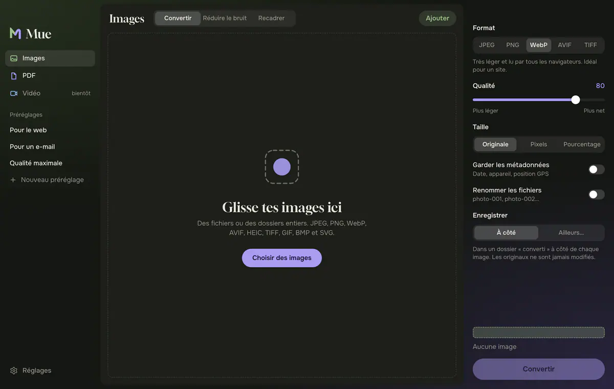
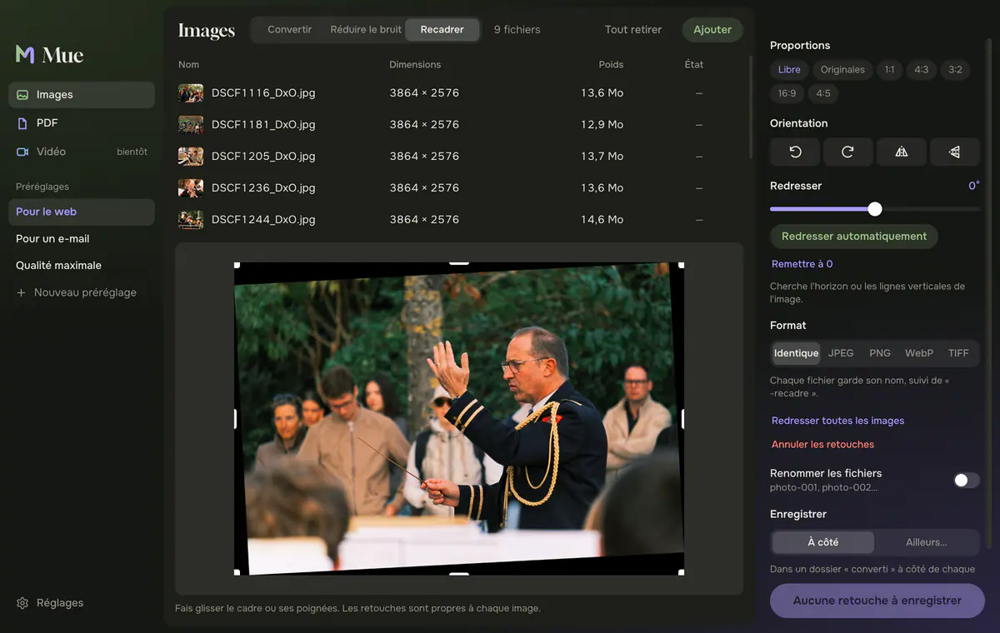
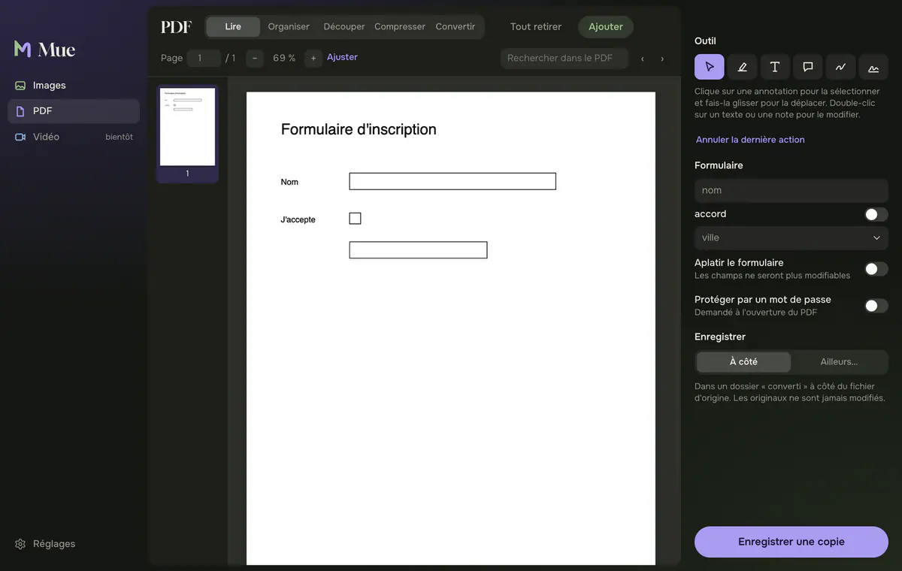
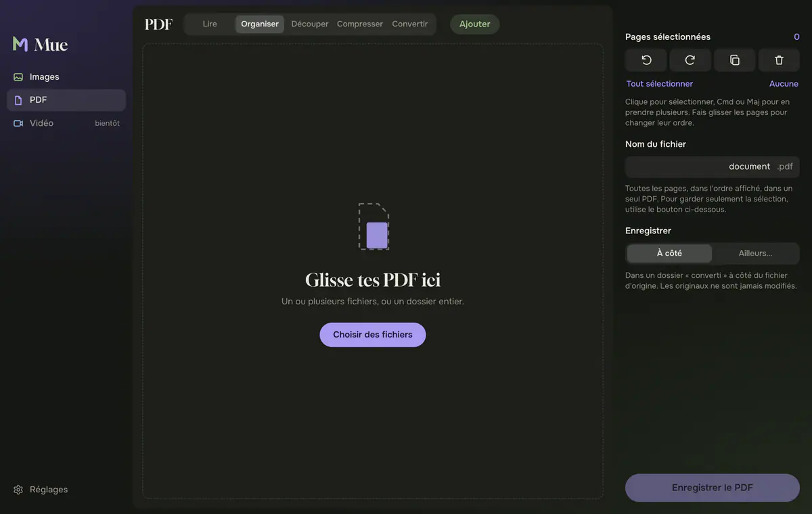
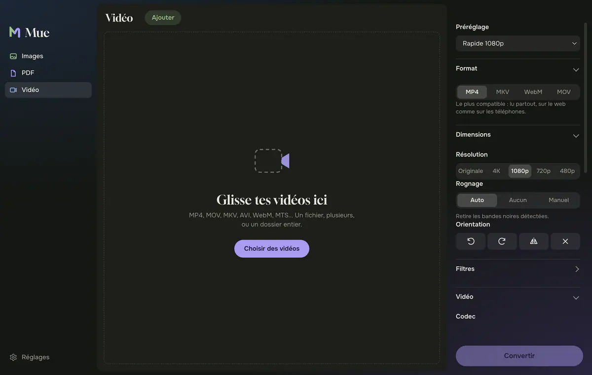

<p align="center">
  
</p>

<h1 align="center">Mue</h1>

<p align="center">Convertir et alléger vos images, vos PDF et vos vidéos, sur Mac.<br>Tout est traité sur votre ordinateur : rien n'est envoyé en ligne.</p>

<p align="center">
  <a href="https://github.com/CyrilCaron/Mue-Software/releases/latest">Télécharger</a> ·
  <a href="CHANGELOG.md">Nouveautés</a> ·
  <a href="LICENSE">Licence GPL-3.0</a>
</p>



## Images

- Lit le JPEG, le PNG, le WebP, l'AVIF, le HEIC de l'iPhone, le TIFF, le GIF, le BMP et le SVG. Enregistre en JPEG, PNG, WebP, AVIF ou TIFF.
- Curseur de qualité, avec le poids estimé de chaque image avant la conversion.
- Redimensionnement par largeur ou hauteur maximale, ou en pourcentage.
- Réduction du bruit avec comparaison avant / après à taille réelle.
- Recadrage, rotation, miroir et redressement automatique (détection de l'horizon et des verticales).
- Métadonnées et position GPS retirées par défaut, renommage en série, préréglages personnels.



## PDF

- Lecteur avec miniatures, zoom et recherche dans le texte.
- Surlignage, texte, notes, dessin à main levée et signature.
- Remplissage des formulaires, protection par mot de passe, ouverture des PDF protégés.
- Organisation des pages (réordonner, pivoter, dupliquer, supprimer) et fusion de plusieurs fichiers.
- Découpe par page, toutes les N pages ou par plages ; compression des images du PDF ; conversion PDF ↔ images.

| Annoter et signer | Organiser les pages |
| --- | --- |
|  |  |

## Vidéo

- Sortie MP4, MKV, WebM ou MOV, en H.264, H.265, AV1, VP9 ou ProRes, avec l'encodage matériel du Mac.
- Qualité constante, débit moyen ou poids visé en Mo ; neuf préréglages.
- Rognage automatique des bandes noires, résolution, rotation, désentrelacement, débruitage, netteté.
- Choix des pistes audio et des sous-titres (gardés ou incrustés), chapitres, découpe d'un passage.
- Aperçu image par image et file d'attente avec temps restant.



## Installer

Téléchargez le fichier `.dmg` de la [dernière version](https://github.com/CyrilCaron/Mue-Software/releases/latest), ouvrez-le et glissez Mue dans Applications. Mue fonctionne sur les Mac à puce Apple (M1 et suivants). Une version Windows est prévue.

L'app n'est pas encore signée par Apple : la première fois, faites un clic droit sur Mue puis choisissez **Ouvrir**.

## Développer

Il faut Node.js 20 ou plus récent et les outils en ligne de commande de Xcode (pour `swiftc`).

```bash
npm install
npm start      # lance l'app
npm test       # teste les moteurs images, PDF et vidéo
npm run dist   # construit dist/Mue-<version>-arm64.dmg
```

| Dossier | Contenu |
| --- | --- |
| `src/engine.js` | Images : conversion, estimation du poids, réduction du bruit, retouches (sharp et libvips). Le HEIC est décodé par `sips`. |
| `src/denoise.js`, `src/transform.js` | Filtre guidé, géométrie et détection d'inclinaison. |
| `src/pdf.js` | PDF : assemblage, découpe, compression, annotations, formulaires (pdf-lib). |
| `native/pdfkit.swift` | Petit utilitaire macOS pour chiffrer et ouvrir les PDF protégés. |
| `src/video.js` | Vidéo : analyse et réencodage avec ffmpeg. |
| `src/renderer/` | Interface (HTML, CSS et JavaScript sans framework), PDF.js dans `vendor/`. |
| `test/` | Tests des moteurs. |

## Licence

Mue est distribué sous licence [GPL-3.0](LICENSE). Les projets libres utilisés sont listés dans [THIRD_PARTY_NOTICES.md](THIRD_PARTY_NOTICES.md).

Conçu par [Cyril Caron](https://cyrilcaron.fr).
